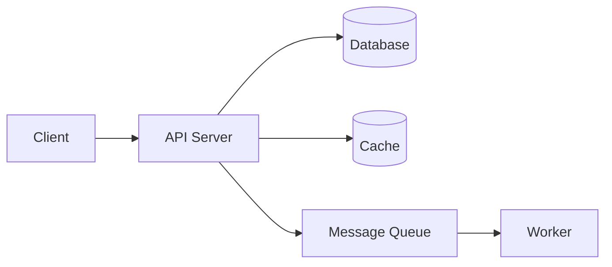
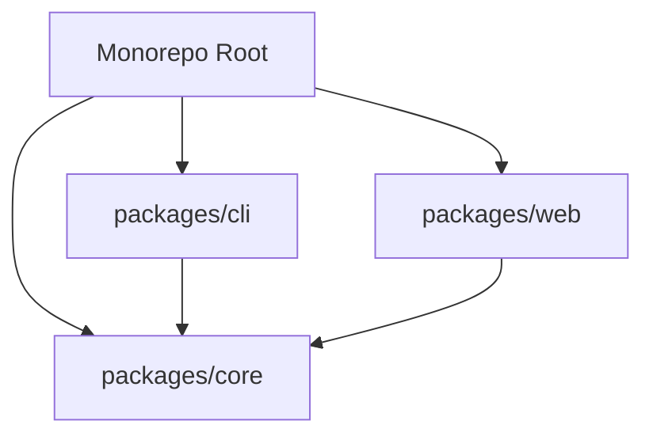
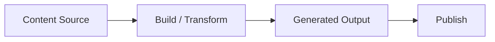
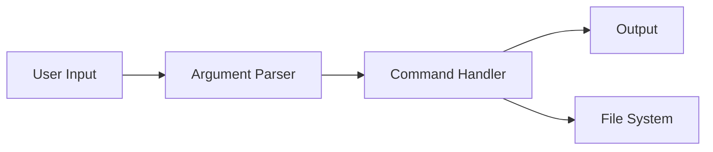
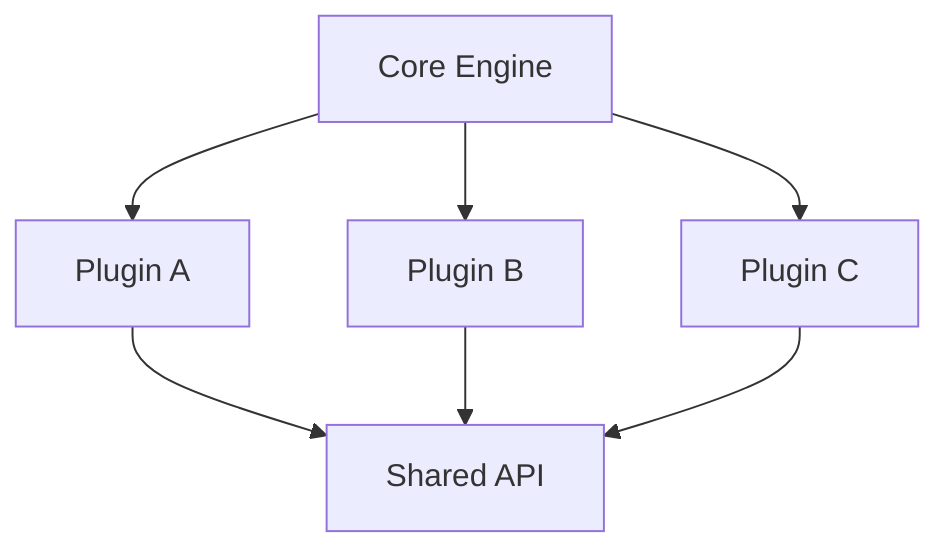

# Mermaid Diagram Templates

Use diagrams for meaningful component relationships or data flow, not as decoration. Adapt these templates to the actual project; omit nonexistent databases, caches, workers, packages, and deployment stages. Simple libraries, utilities, and documentation-only repos often do not need a diagram.

## API / Web App

## Monorepo

## Content Pipeline

## CLI Tool

## Plugin Architecture

Check that the Mermaid code fences are balanced, labels are readable, and arrows accurately represent dependencies or data flow; explain arrow meaning if it is ambiguous.
