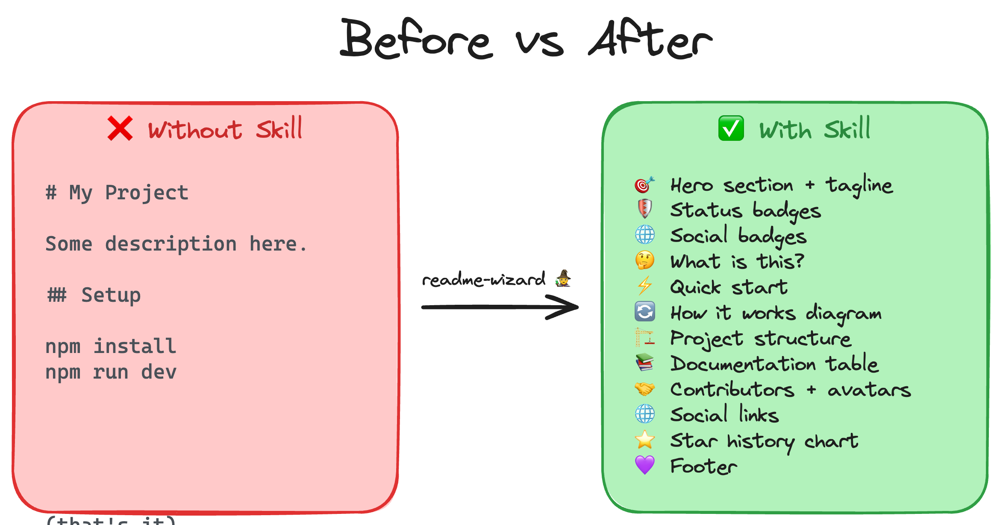

<div align="center">

# Learn Agent Skills

Build reusable agent skills through seven hands-on tutorials, from your first greeting skill to a README Wizard.

[](LICENSE)
[](https://github.com/debs-obrien/learn-agent-skills/stargazers)

[](https://youtu.be/2REiUlciObk?si=im87wwgj8vcN91br)

</div>

## What is this?

Learn Agent Skills is a hands-on tutorial series for developers learning to build agent skills from scratch. Skills are reusable instructions that teach AI coding agents (GitHub Copilot, Claude Code, Cursor, and others) how to perform specific tasks well. Follow the tutorials in order and build a fully working README Wizard skill by the end.



## Quick Start

This is a documentation-only project: no application dependencies, build step, or server is required. Start with an editor and a skills-compatible AI coding agent, such as GitHub Copilot, Claude Code, or Cursor.

| Tool | When you need it |
|------|------------------|
| Git | Cloning repositories and reading local remote configuration; not required to read an extracted download |
| Bash and Python 3.8+ | Running the optional project scanner; use Git Bash or WSL on Windows |
| Node.js with npm | Installing or sharing skills with the `npx skills` commands in Tutorial 7 |

Clone the tutorial repository (or open your extracted download):

```bash
git clone https://github.com/debs-obrien/learn-agent-skills.git
cd learn-agent-skills
```

Start with [Tutorial 1: Build Your First Skill](01_build-first-agent-skill.md). Read the lessons in order and paste each **Copy this prompt** block into your agent's chat. Your first result is a greeting skill; by the end, you will have built and evaluated a README Wizard.

### Set up a practice project

Keep this repository as a guide and reference implementation. Create a separate workspace alongside it for the exercises:

```bash
cd ..
mkdir readme-wizard-lab
cd readme-wizard-lab
```

Open the practice workspace in your editor and build your skills there. Use its README, another project you own, or a cloned public repository to test the README Wizard. Compare your work with the [reference skill](.agents/skills/readme-wizard/SKILL.md) when you need to check its structure or troubleshoot a step.

**Claude Code users:** Use `.claude/skills/` instead of `.agents/skills/` in the tutorial prompts.

## Project Structure

The scanner shows the first two visible levels, with hidden configuration and generated content omitted. The skill files under `.agents/skills/` are linked in [Skill reference](#skill-reference).

```text
├── assets/
│   ├── anatomy-of-a-skill.png
│   ├── before-vs-after.png
│   ├── how-skills-get-loaded.png
│   ├── the-build-loop.png
│   └── the-refactor.png
├── 01_build-first-agent-skill.md
├── 02_skill-deep-dive.md
├── 03_build-readme-wizard-skill-part_1.md
├── 04_build-readme-wizard-skill-part_2.md
├── 05_build-readme-wizard-skill-part_3.md
├── 06_build-readme-wizard-skill-part_4.md
├── 07_share-your-skill.md
├── CLAUDE.md
├── LICENSE
└── README.md
```

## Documentation

### Tutorials

| # | Tutorial | What you'll learn |
|---|----------|-------------------|
| 1 | [Build Your First Skill](01_build-first-agent-skill.md) | What skills are, how they work, and build a simple one |
| 2 | [Anatomy of a Skill](02_skill-deep-dive.md) | The folder structure, how skills get loaded, and progressive disclosure |
| 3 | [Build the README Wizard — Phase 1](03_build-readme-wizard-skill-part_1.md) | Set up a practice project, create the skill folder, write a basic SKILL.md, and test it |
| 4 | [Build the README Wizard — Phase 2](04_build-readme-wizard-skill-part_2.md) | Add detail: badges, best practices, templates, and diagrams |
| 5 | [Build the README Wizard — Phase 3](05_build-readme-wizard-skill-part_3.md) | Refactor into the skill folder structure with references, assets, and scripts |
| 6 | [Build the README Wizard — Phase 4](06_build-readme-wizard-skill-part_4.md) | Add validation, evals, and test end-to-end |
| 7 | [Share Your Skill](07_share-your-skill.md) | Push to GitHub and install with the skills CLI |

### Try the README Wizard

**Use the local version:** This repository contains the editable [README Wizard skill](.agents/skills/readme-wizard/SKILL.md). To test it here, open this folder with an agent that discovers `.agents/skills/`, then ask:

```text
Improve the README for this project. Use the readme-wizard skill: run the scan script first, then follow the SKILL.md instructions.
```

**Install the published version:** Open your target project in your agent-enabled editor, then run:

```bash
npx skills add debs-obrien/readme-wizard
```

This installs the published skill, so changes made to the local reference skill are not included.

Then ask your agent:

```text
Improve the README for this project using the readme-wizard skill.
```

For sharing, installation scope, and agent-specific options, see [Tutorial 7](07_share-your-skill.md).

### Skill reference

| Resource | Purpose |
|----------|---------|
| [README Wizard instructions](.agents/skills/readme-wizard/SKILL.md) | Metadata discovery, README structure, and review workflow |
| [Writing guide](.agents/skills/readme-wizard/references/readme-best-practices.md) | Structure, tone, and adapting the README to the project |
| [README template](.agents/skills/readme-wizard/assets/readme-template.md) | Starting layout for generated READMEs |
| [Badge catalog](.agents/skills/readme-wizard/assets/badges.json) | Status, social, and package badge URL templates |
| [Diagram templates](.agents/skills/readme-wizard/assets/diagrams.md) | Mermaid examples for projects with components or data flow |
| [Project scanner](.agents/skills/readme-wizard/scripts/scan_project.sh) | Bash helper that outputs project metadata as JSON |
| [Evaluation cases](.agents/skills/readme-wizard/evals/evals.json) | Four scenarios with assertions to review manually or with an agent |

### Scan a project

From the tutorial repository root, run:

```bash
bash .agents/skills/readme-wizard/scripts/scan_project.sh .
```

The result is JSON containing project metadata, package manager, CI setup, social links grouped by platform, and a two-level directory tree. Unknown values are empty strings or arrays. The scanner reads local files and Git configuration only; it makes no network requests. To scan another project, replace the final `.` with its directory path, quoted if it contains spaces.

### Review the result

To review a generated README, use the four [evaluation cases](.agents/skills/readme-wizard/evals/evals.json): direct improvement, a casual request, a small script, and badge-focused changes. Check their plain-English assertions against actual project data. These are review scenarios, not an automated test runner.

## Contributing

Contributions are welcome through issues and pull requests for tutorial corrections, clearer examples, or skill improvements.

- For tutorial changes, keep copyable prompts, success checks, and next-step links consistent.
- For README Wizard changes, check the relevant [evaluation assertions](.agents/skills/readme-wizard/evals/evals.json) against output generated from a real project.
- Check that documentation links resolve and commands match the files they describe.

<a href="https://github.com/debs-obrien/learn-agent-skills/graphs/contributors">
  
</a>

## License

MIT License — see [LICENSE](LICENSE) for details.

---

<div align="center">

[](https://star-history.com/#debs-obrien/learn-agent-skills&Date)

</div>
